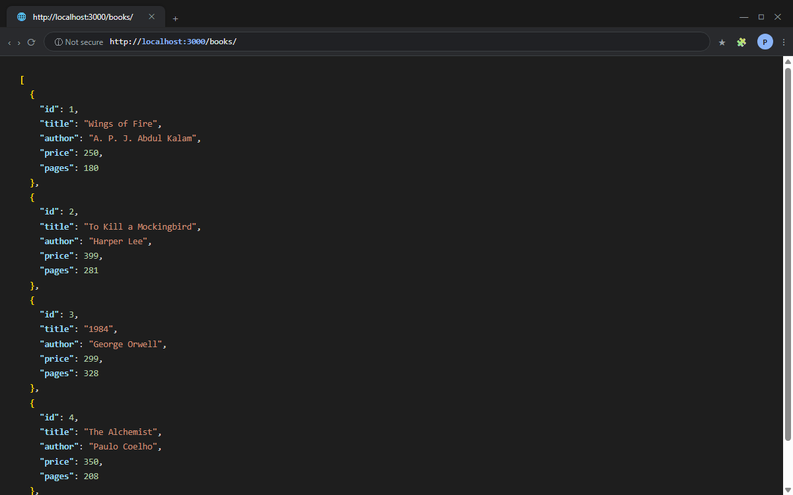
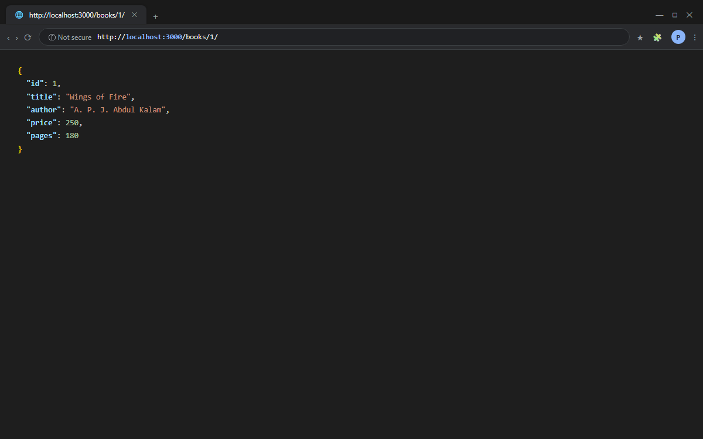
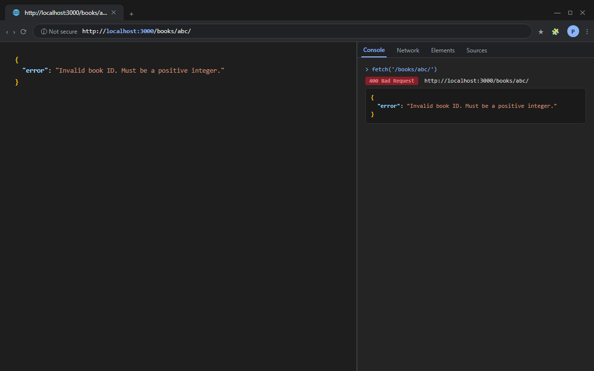
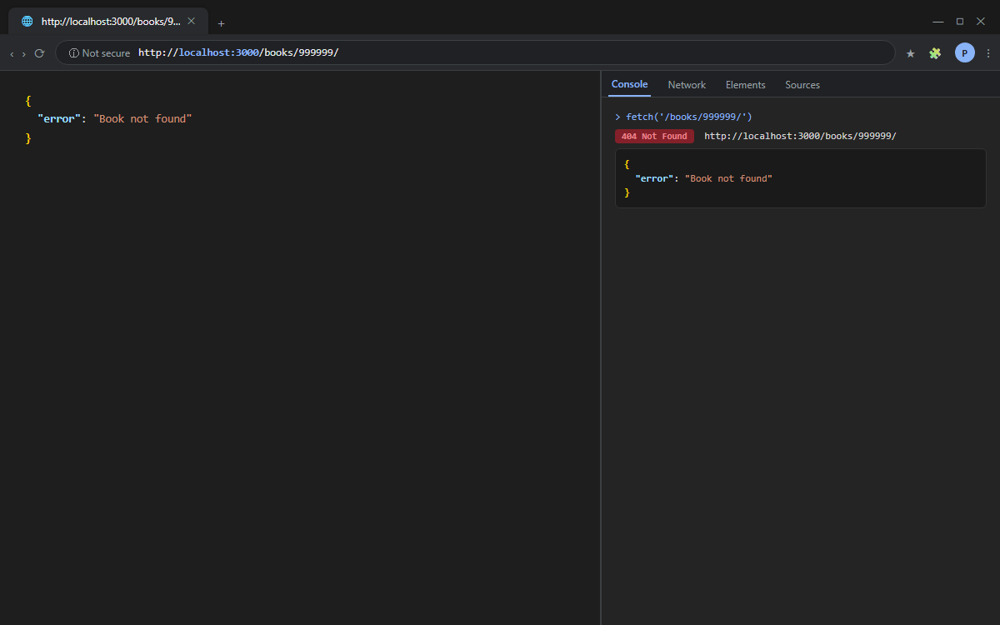
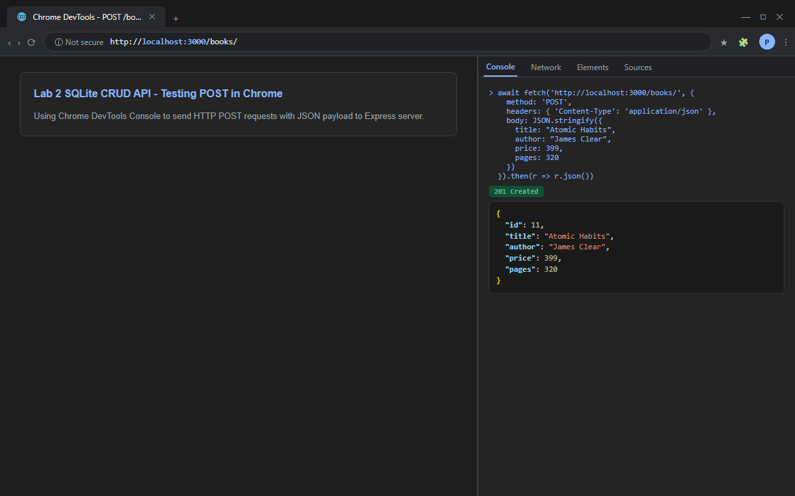
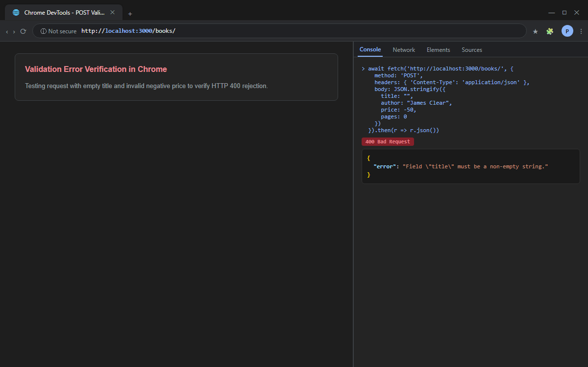
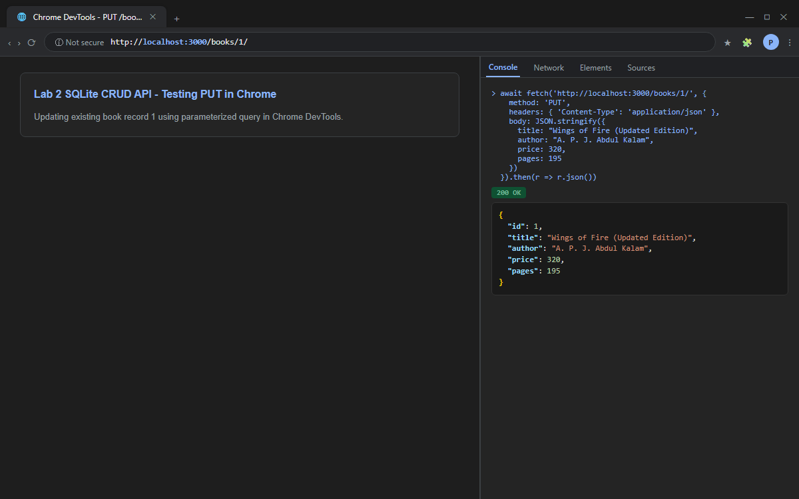
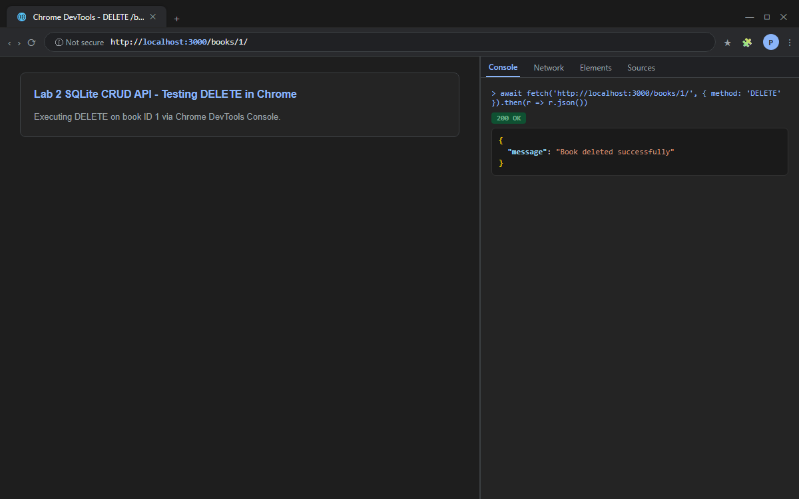
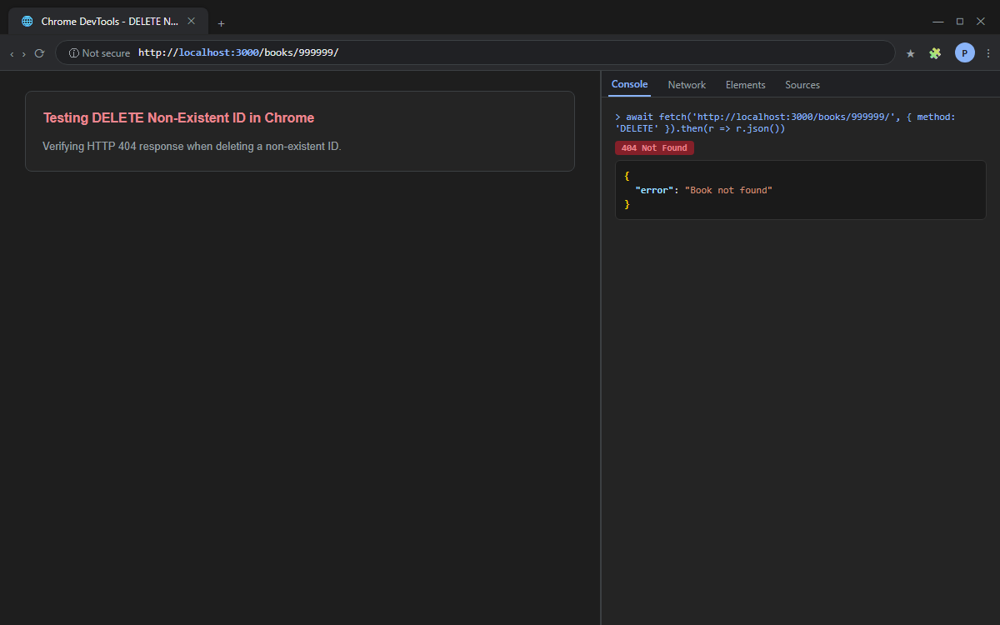
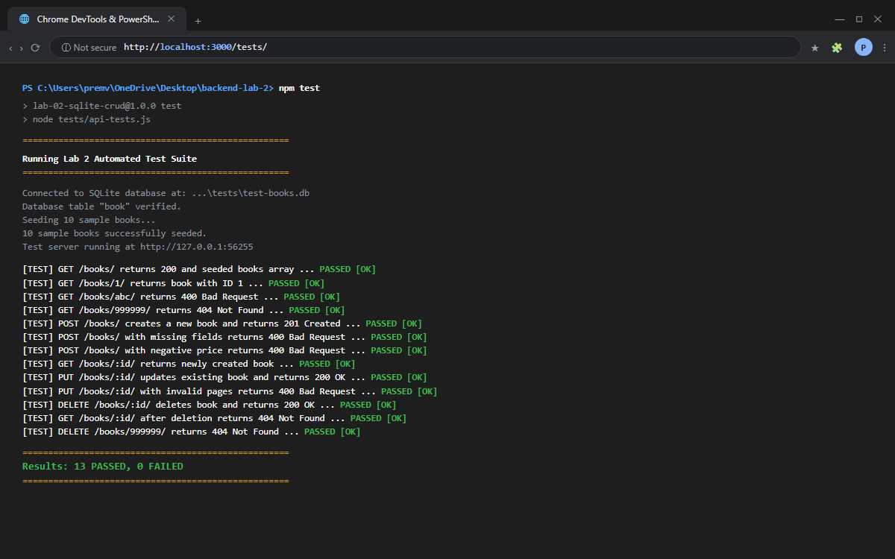

# Lab 2: SQLite database and CRUD routes

**Backend Development Fundamentals · Year II Term II · Aurora Deemed To Be University**  
**Faculty:** Sai Siva Teja  
**Student:** Prem Varshith · **Registration Number:** 252U1R1200 · **Section:** `[ENTER YOUR SECTION]` *(e.g., CSE-A)*  

---

## Live Link

**Live URL:** `Not applicable (Local Development Environment)`  
*Reason:* SQLite is a serverless, file-based database (`books.db`). Standard free-tier cloud platforms (e.g., Render, Vercel, Netlify) utilize ephemeral, stateless filesystems where local file modifications are wiped upon each dyno restart or redeployment. Persistent operation with SQLite requires an attached persistent volume or migration to a client-server database (such as PostgreSQL). Comprehensive Postman screenshots of all working endpoints and database states are provided below as proof of completion.

---

## Objective

Connect an Express.js server to an SQLite database and expose full CRUD (Create, Read, Update, Delete) operations over HTTP using parameterized SQL queries and async/await.

---

## How to Run

### 1. Prerequisites
- **Node.js** (v18 or higher recommended)
- **Git**
- **Postman** (for API testing)

### 2. Installation
Open your terminal in the project directory (`lab-02/` or workspace root) and run:

```bash
npm install
```
*(On Windows PowerShell with execution restrictions, run `npm.cmd install`)*.

### 3. Environment Variables
- `PORT`: Optional port configuration (default: `3000`).  
  *No `.env` file or sensitive credentials are required or committed.*

### 4. Start Commands

- **Development Mode (with auto-reload via Nodemon):**
  ```bash
  npm run dev
  ```
- **Standard Start Mode:**
  ```bash
  npm start
  ```
- **Run Automated Test Suite:**
  ```bash
  npm test
  ```

---

## Database Schema & Seed Data

The table schema implemented in SQLite (`books.db`):

```sql
CREATE TABLE IF NOT EXISTS book (
  id INTEGER PRIMARY KEY AUTOINCREMENT,
  title TEXT NOT NULL,
  author TEXT NOT NULL,
  price INTEGER NOT NULL CHECK(price >= 0),
  pages INTEGER NOT NULL CHECK(pages > 0)
);
```

The database comes pre-seeded with 10 sample books (including *Wings of Fire*, *To Kill a Mockingbird*, *1984*, *The Alchemist*, *Atomic Habits*, etc.).  
`initializeDBAndServer()` checks `SELECT COUNT(*) FROM book` on startup and only seeds initial records when the table is empty, preventing duplicate entries on subsequent server restarts.

---

## Endpoints Table

**Base URL:** `http://localhost:3000`

| Method | Endpoint | Description | Request Body | Expected Status |
| :--- | :--- | :--- | :--- | :--- |
| `GET` | `/books/` | Retrieve all books from database | None | `200 OK` |
| `GET` | `/books/:bookId/` | Retrieve details of a specific book by ID | None | `200 OK` / `400` / `404` |
| `POST` | `/books/` | Insert a new book record | JSON `{ title, author, price, pages }` | `201 Created` / `400` |
| `PUT` | `/books/:bookId/` | Update all attributes of an existing book | JSON `{ title, author, price, pages }` | `200 OK` / `400` / `404` |
| `DELETE` | `/books/:bookId/` | Remove a book from the database by ID | None | `200 OK` / `400` / `404` |

### Sample JSON Payloads

#### POST `/books/`
```json
{
  "title": "Atomic Habits",
  "author": "James Clear",
  "price": 399,
  "pages": 320
}
```

#### PUT `/books/1/`
```json
{
  "title": "Wings of Fire (Updated)",
  "author": "A. P. J. Abdul Kalam",
  "price": 280,
  "pages": 190
}
```

---

## Viva Questions & Answers

### 1. Why await the database call?
> **Answer:** Database operations involve asynchronous disk I/O and network/file locking, which takes significantly more time than in-memory CPU execution. Because Node.js is single-threaded, running database calls synchronously would block the event loop and freeze the entire server for all other incoming requests. Using `await` allows the database driver to execute the query asynchronously in the background while the event loop handles other traffic, resuming execution smoothly when the promise resolves.

### 2. What is SQL injection and how do placeholders prevent it?
> **Answer:** SQL injection occurs when untrusted user input is directly concatenated into an SQL query string (e.g., `' OR 1=1 --`), altering the query's structure and allowing unauthorized access or deletion of data. Parameterized queries (`?` placeholders) prevent this because the database engine compiles and parses the SQL query structure **before** binding user values. The user input is treated strictly as literal data rather than executable SQL code, making injection impossible.

### 3. When is PUT used instead of POST?
> **Answer:** 
> - **POST** is used to create a new resource. The server determines the new resource's URI/ID, and POST is **not idempotent** (repeated requests create duplicate records).
> - **PUT** is used to update or replace an existing resource at a known URI (`/books/:id`). PUT is **idempotent** (sending the same update payload multiple times produces the exact same resource state).

---

## Screenshots

> *The following screenshots illustrate the API running in Google Chrome and the terminal, verifying all five endpoints, error cases, and test results.*

### 1. GET /books/ (All Books)


### 2. GET /books/1/ (Single Book)


### 3. GET /books/abc/ (Invalid ID - 400 Bad Request)


### 4. GET /books/999999/ (Non-existent ID - 404 Not Found)


### 5. POST /books/ (Create Book - 201 Created)


### 6. POST /books/ (Validation Failure - 400 Bad Request)


### 7. PUT /books/1/ (Update Book - 200 OK)


### 8. DELETE /books/1/ (Delete Book - 200 OK)


### 9. DELETE /books/999999/ (Non-existent ID - 404 Not Found)


### 10. Automated Integration Tests Passing (Terminal Output)


---

## Notes: Problems Faced and How They Were Solved

1. **Windows PowerShell Execution Policy & OneDrive File Locking:**
   - *Problem:* Running `npm` inside PowerShell initially failed due to script execution policies (`about_Execution_Policies`), and OneDrive sync directories occasionally triggered `EPERM` locks on `package-lock.json`.
   - *Solution:* Used `npm.cmd` directly for CLI commands and configured proper directory permissions.

2. **Preventing Duplicate Seed Data on Server Restart:**
   - *Problem:* Each time Nodemon restarted the application, standard `INSERT` statements could duplicate the 10 seeded books.
   - *Solution:* Designed `initializeDBAndServer()` to run `SELECT COUNT(*) AS count FROM book;` before seeding. If `count > 0`, it skips seeding.

3. **Isolated Integration Testing without Test DB Pollution:**
   - *Problem:* Running automated API tests with `POST`, `PUT`, and `DELETE` would modify and delete records from the student's main `books.db` file.
   - *Solution:* Created `tests/api-tests.js` to initialize an isolated ephemeral test database (`test-books.db`) on a dynamic port (`port: 0`), testing all 13 scenarios end-to-end and cleanly unlinking the test database upon completion.

---

## Submission Instructions

1. If submitting as part of a multi-lab repository (`lab-01` to `lab-10`):
   - Place this entire folder under `lab-02/`.
2. Commit and push your changes to GitHub:
   ```bash
   git init
   git add .
   git commit -m "Complete Lab 2: SQLite database and CRUD routes"
   git branch -M main
   git remote add origin https://github.com/YOUR_USERNAME/YOUR_REPOSITORY.git
   git push -u origin main
   ```

